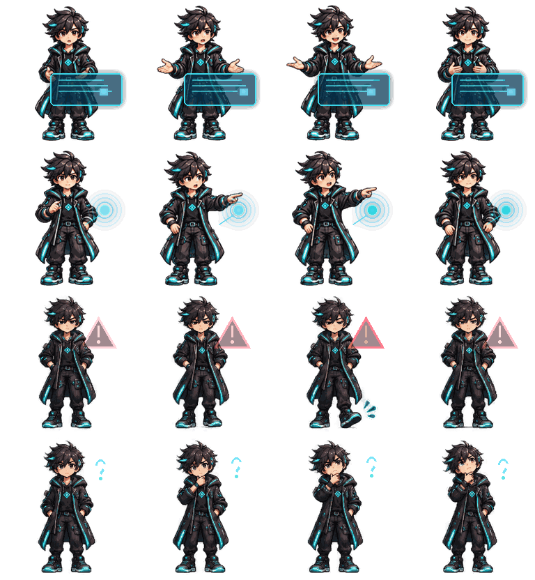
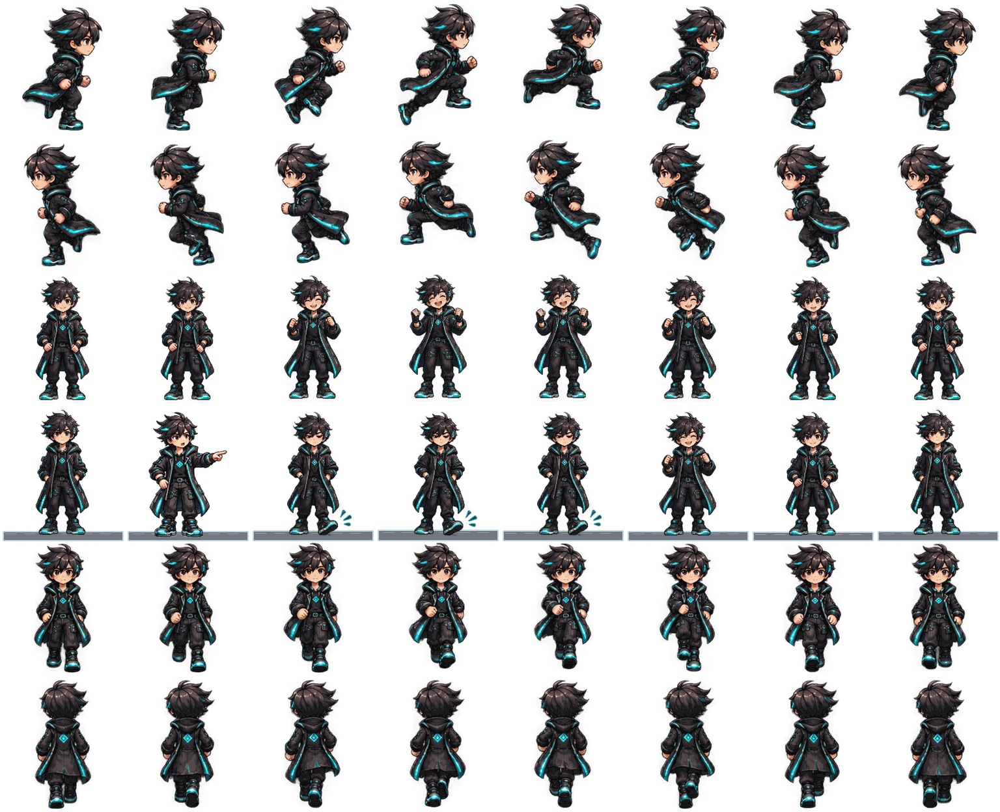
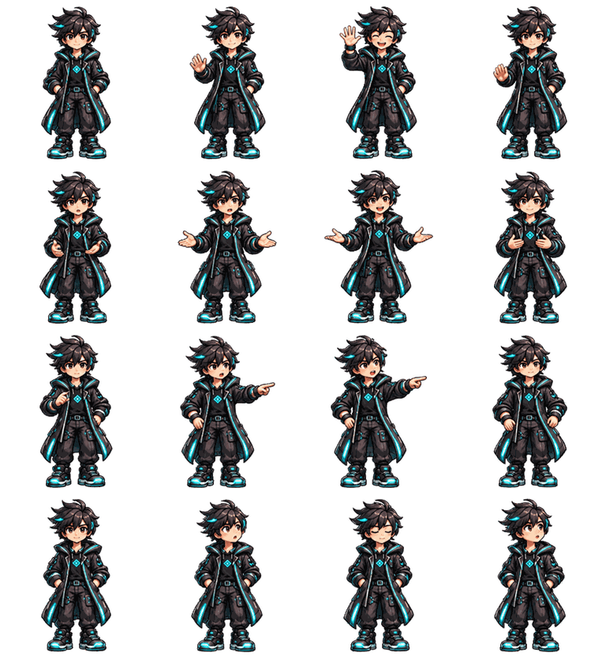
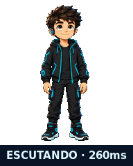
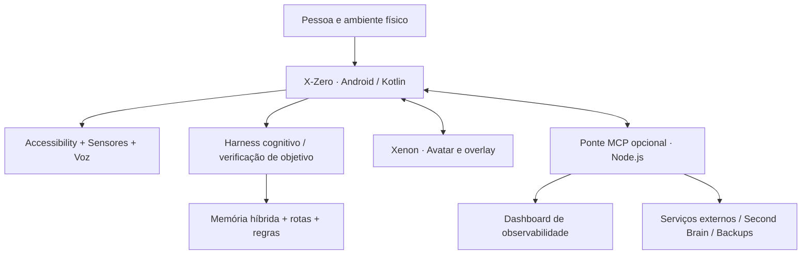
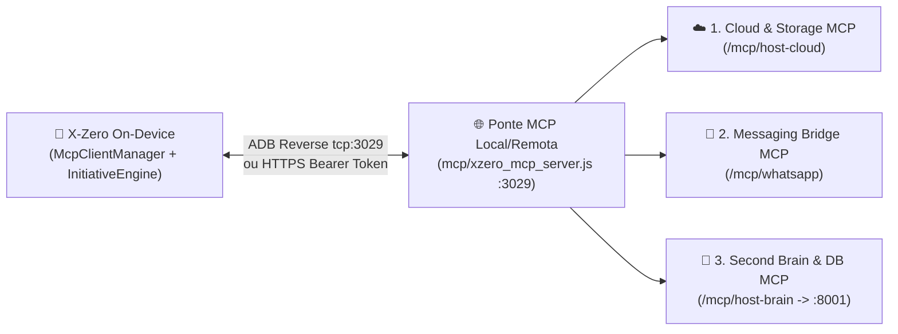

<div align="center">

# X-ZERO · Cognitive Android Agent

### Um agente cognitivo para Android, com avatar vivo, automação contextual, memória e integração MCP


**Android / Kotlin · AccessibilityService · Node.js · MCP · Memória híbrida · Sensor Fusion**

[Começar](#-quickstart--começando-em-5-minutos) · [Arquitetura](#-arquitetura-dos-mcps-e-do-second-brain-como-eu-conectei-e-o-que-você-precisa-ter) · [Recursos](#-por-que-este-repositório-existe-o-que-há-de-novo-para-o-mundo-da-ia) · [Documentação técnica](docs/ARQUITETURA_TECNICA.md) · [Contribuir](#-contribua-com-este-sonho)

</div>

> **Status:** projeto experimental e open-source, em evolução. Parte das integrações exige serviços externos e configuração própria. As capacidades abaixo refletem a implementação documentada no repositório; não representam garantia de autonomia irrestrita nem operação segura em qualquer aparelho.

## 👀 Conheça o X-Zero

O **X-Zero** pesquisa como um assistente pode perceber o contexto do Android, planejar ações, verificar seus resultados e continuar tarefas sem se limitar a uma conversa em uma janela de chat. Seu avatar visual, **Xenon**, apresenta informações e sugestões diretamente na interface do dispositivo.

| No dispositivo | Fora do dispositivo |
| --- | --- |
| Acessibilidade, ações na interface e verificação de objetivos | Dashboard de observabilidade e ponte MCP opcional |
| Sensores, eventos, voz e avatar Xenon | Second Brain, cloud e serviços conectados por contratos |
| Memória local, rotas e regras de segurança | Backups e integrações que dependem de configuração |

### Galeria visual — recursos incluídos no projeto

<p align="center">
  
  
</p>

<p align="center"><em>Assets de animação incluídos no código-fonte; não são capturas de tela do aplicativo em execução.</em></p>

<p align="center">
  
  
</p>

### Animações do Xenon

As duas prévias animadas abaixo já estavam versionadas neste repositório. Representam os estados e ações do avatar, **não são gravações de uma sessão pessoal**.

<p align="center">
  
  
</p>

> **Capturas reais do app e dashboard:** não publicadas por padrão. Gravações pessoais e backups privados não são materiais de demonstração seguros sem revisão quadro a quadro, tratamento de áudio, remoção de metadados e nova exportação. A publicação de telas reais deve usar dados sintéticos e um ambiente isolado. Nenhuma mídia do Google Drive ou do WhatsApp foi enviada ao GitHub nesta atualização.

### Como os componentes se comunicam



### Uso responsável e privacidade

O agente pode operar interfaces, observar eventos do telefone e executar comandos. **Teste primeiro em aparelho de desenvolvimento**, conceda apenas as permissões necessárias, mantenha tokens fora do Git e revise ações potencialmente destrutivas (exclusão de arquivos, envio de mensagens, configurações e backups). A presença de mecanismos de confirmação no código não substitui uma auditoria de segurança independente.

---

> ### 🌍 Um Sonho Sem Fins Lucrativos para um Mundo Cada Vez Mais Conectado
> **X-Zero (ADA / Xenon / Reploid)** nasceu de um sonho pessoal: tirar a Inteligência Artificial de dentro de janelas passivas de chat e transformá-la em um **parceiro cognitivo vivo, ético, proativo e consciente do ambiente físico** — morando diretamente no dispositivo que nos acompanha todos os dias.
>
> **Este projeto não tem fins lucrativos.** Ele foi construído em laboratório real ao longo de meses de pesquisa prática e está sendo compartilhado de forma limpa, segura e aberta para que qualquer desenvolvedor, estudante ou pesquisador do mundo possa **começar quase exatamente do ponto em que estou hoje** e ajudar a levar essa visão adiante.

---

## 🔬 Por Que Este Repositório Existe? (O Que Há de Novo para o Mundo da IA)

Hoje, no ecossistema open-source de agentes para Android (`Opendroid`, `mobile-next/mobile-mcp`, `android-remote-control-mcp`, `Phone-MCP`, `AppAgent`, `Mobile-Agent-v2`), os projetos existentes costumam focar em apenas um recorte: ou são scripts em Python rodando no PC via ADB, ou são servidores MCP que apenas expõem cliques na tela sem inteligência própria no aparelho.

O **X-Zero Open Edition** entrega para a comunidade, em um único repositório nativo Android (Kotlin) + Ponte MCP Node.js, **uma arquitetura cognitiva integrada para experimentação**:

1. **Harness Cognitivo 100% On-Device com Atribuição Causal (`Agent.kt`):**
   - Não depende de PC conectado para pensar ou agir. Lê a árvore nativa do `AccessibilityService` em tempo real, compara o estado *antes* e *depois* de cada ação (`preActionScreen` $\to$ `postActionScreen`), detecta progresso real vs. estagnação (`stagnantSteps`) e separa estritamente `agent_declared_done` de `goal_verified` (`verifyGoalCompletion`).
2. **Co-Piloto Proativo de Continuação de Fluxo (`InitiativeEngine.kt` + `PassiveHabitTracker.kt`):**
   - Em vez de esperar ordens passivamente, o X-Zero observa o contexto do que você começou a fazer e sugere o próximo passo:
     - **Continuação de Limpeza de Armazenamento:** Começou a limpar espaço ou abriu o gerenciador de arquivos? Ele já varre `/sdcard` em background (`escanearArquivosGrandesRapido`) e sugere na tela os **caminhos exatos e tamanhos dos maiores arquivos** (`DCIM/Camera/...`, `Movies/...`, `Download/...`), oferecendo fazer backup antes de você apagar.
     - **Pesquisa Proativa Trazida para a Tela:** Comentou uma dúvida técnica ou erro enquanto trabalha? Ele pesquisa em segundo plano (Web + Second Brain) e traz um resumo direto para o balão na tela.
     - **Alerta de Logs Críticos e Armazenamento Cheio:** Monitora armazenamento crítico (`< 10%`), superaquecimento da bateria (`>= 41°C`), memória RAM baixa, quedas de serviço e logs críticos do servidor, avisando antes que o sistema trave.
3. **Memória Grafo-Vetorial Híbrida + Aprendizado por Reforço $Q(s,a)$ (`KnowledgeGraphMemory.kt`):**
   - Grafo semântico com busca por cosseno (palavras + trigramas tolerantes a erros de STT), tabela $Q(s,a)$ atualizada em tempo real com retropropagação terminal ($\gamma = 0.82$) e consolidação automática de **Rotas Campeãs**.
4. **Voz Contínua Estilo ChatGPT Live (`0 Tokens` em Silêncio/Conversa Paralela) + `/btw` (`AmbientContextEngine.kt`):**
   - Wake word offline (`Sherpa-ONNX`) + avaliador de intenção 100% local que mantém uma janela deslizante de contexto sem gastar 1 token de LLM enquanto você conversa com outras pessoas.
   - **Injeção `/btw` em Paralelo:** Agite o celular (**Shake Gesture**) ou fale `/btw` enquanto o agente está pensando para adicionar contexto, recalcular a rota ou mudar a tarefa em tempo real sem perder os passos já concluídos.
5. **Fusão com 8 Sensores Físicos & Ética Ambiental (`ProactiveWatcher.kt`):**
   - Controle dinâmico de Luz Ambiente (`lux`), Acelerômetro (detecta quando o celular é pego da mesa — *Pick-Up Gesture*), Proximidade (bolso/rosto), Giroscópio, Contador de Passos, Bússola e Barômetro.
   - **Auto-Silêncio Inteligente:** Se perceber quarto escuro (`< 8 lux`) ou celular no bolso/reunião, troca a fala em voz alta por notificações silenciosas (`post_notification`).
6. **Mascote Vivo `Xenon` 2-Slots & Máquina de Estados (`XenonSpriteView.kt` + `AdaStateMachine.kt`):**
   - Avatar em corpo inteiro (`116x126dp`) renderizado em pixel-art sem distorção de DPI, com física de movimento 2D (`AvatarMotionController`), balão de fala sincronizado quadro a quadro e rotina de vida autônoma (trabalha no notebook holográfico durante consolidação de memória, desce pela borda da tela, reage a descobertas).
7. **Ponte MCP Bidirecional + Integração com Second Brain (`mcp/xzero_mcp_server.js`):**
   - O celular consome ferramentas de servidores MCP externos (Backup em nuvem, Banco de Dados, Second Brain RAG/Grafo) e também pode ser operado por IAs externas (ChatGPT Web via OAuth 2.0 + PKCE, Claude Code, Gemini/Antigravity).

---

## ⏳ Linha do Tempo: Como Chegamos Até Aqui (Fev 2026 – Nov 2026)

Para que você entenda a maturidade do código que está recebendo, esta foi a linha do tempo real de construção do projeto:

| Período | Marco de Engenharia | O Que Foi Construído e Validado |
| :--- | :--- | :--- |
| **Fev – Mar 2026** | **1. Concepção Reploid X** | Definição da filosofia em 4 fases (*Fundação: receber $\to$ planejar $\to$ executar $\to$ registrar evidência; Sobrevivência; Autonomia; Evolução*) e criação do conceito de Cockpit de Engenharia. |
| **Abr – Jun 2026** | **2. Second Brain (`XCore`)** | Criação do cérebro externo em FastAPI + ChromaDB + SQLAlchemy Knowledge Graph multi-hop, indexador ocioso de documentos e governança autônoma de memória. |
| **Out – Nov 2026** | **3. Nascimento do X-Zero Android** | Implementação do agente nativo em Kotlin operando sobre `AccessibilityService`, `NotificationListenerService`, `WindowManager` (overlay flutuante), `Camera2` e `MediaRecorder`. |
| **Nov 2026 (Sem. 1–2)** | **4. Harness Cognitivo & $Q(s,a)$** | Diff causal de tela (`preActionScreen` $\to$ `postActionScreen`), `GoalVerifier` determinístico, `KnowledgeGraphMemory` com política $Q(s,a)$, `RuleEngine` (guardrails `BLOCK`/`CONFIRM`/`BEHAVIOR`) e Testbed JVM com **56 testes offline**. |
| **Nov 2026 (Sem. 2–3)** | **5. Xenon 2-Slots, Sensores & Voz Live** | Spritesheets pixel-art 8x11 do Xenon, wake word offline (`Sherpa-ONNX`), `AmbientContextEngine` (voz fluida + `/btw` via shake), fusão com 8 sensores físicos e **X-Zero Studio** (gravador de demos com câmera PiP). |
| **20–22 Nov 2026** | **6. Ponte MCP, FSM & FastPath (<50ms)** | Hub MCP bidirecional (`:3029` / `:3033` OAuth2 PKCE), `AdaStateMachine`, `AvatarMotionController`, `FastPathRouter` (`< 50ms` para comandos diretos sem LLM), `PersonaStore` editável em runtime e `HealthMonitor` com self-healing e backoff exponencial. |
| **23 Nov 2026** | **7. Co-Piloto Proativo & Edição Open-Source** | Evolução do `InitiativeEngine` para continuação ativa de tarefas (varredura automática de caminhos de arquivos grandes ao limpar armazenamento, pesquisa proativa na tela e alertas de logs críticos) + sanitização completa para lançamento comunitário. |

---

## 🔍 Como Está o Meu Sistema Atual em Produção vs. O Que Você Recebe Neste Repositório Limpo

Este repositório foi gerado diretamente a partir da minha árvore de produção (**X-Zero Open Edition**), mas passou por uma **separação de dados pessoais e configuração de exemplo** para que você tenha **uma base de engenharia destinada a testes e adaptação, sem incluir intencionalmente dados pessoais do ambiente original**:

### O Que Está Funcionando no Meu Ambiente Atual (e que já vem pronto no código):
- **Testado em ambiente Android de desenvolvimento**, com respostas de voz curtas e naturais (8 a 18 palavras), rigor epistêmico em 3 níveis (`OBSERVED`, `INFERRED`, `UNVERIFIABLE`) e zero alucinação visual.
- **30+ ferramentas nativas prontas** em `Agent.kt` + `FastPathRouter.kt` (`< 50ms`) + `HealthMonitor.kt` (auto-recuperação de Acessibilidade, fechamento automático de diálogos ANR do Android e retomada de tarefa pós-crash via `TaskCheckpoint.kt`).
- **Co-Piloto Proativo (`InitiativeEngine.kt` + `PassiveHabitTracker.kt`)** ativo: aprende transições de apps por faixa horária sem jamais ler apps bancários/senhas, escreve um diário local auditável em Markdown (`files/diario/AAAA-MM-DD.md`), sugere caminhos de arquivos grandes quando você limpa o armazenamento e alerta sobre logs críticos.
- **56 testes automatizados de Harness Cognitivo** em `./testbed/run.sh` validando diff causal, verificação de objetivo, política $Q(s,a)$ e guardrails antes de cada compilação.

### O Que Foi Limpo / Sanitizado Neste Repositório para Você Começar do Zero:
- **Memórias Pessoais & Contatos Removidos:** O projeto foi preparado para não incluir conversas e dados pessoais de operação. Isso não substitui auditoria independente de arquivos, histórico Git e dependências.
- **`USER_PROFILE.md` e `PERSONALITY.md` Limpos:** Em `app/src/main/assets/persona/`, você encontrará templates limpos e documentados para colocar o **seu nome**, o **seu estilo de comunicação** e os **seus contatos de confiança**.
- **Grafo de Conhecimento Inicial Limpo:** O `KnowledgeGraphMemory.kt` inicia apenas com conceitos estruturais do próprio agente e aprenderá as **suas** rotinas e preferências desde o primeiro dia.
- **Chaves e Tokens Isolados em Variáveis de Ambiente:** Nenhuma chave de API (`Gemini`, `Claude`, `OpenAI`, `Groq`, `MCP`) está no código; tudo é configurado pela tela do próprio app Android ou via `.env.mcp` (a partir do `.env.mcp.example`).

---

## 🔌 Arquitetura dos MCPs e do Second Brain (Como Eu Conectei e o Que Você Precisa Ter)

Por segurança e privacidade, **meus servidores MCP pessoais e meu Second Brain (que contêm minhas notas particulares, bancos de dados e sessões de WhatsApp) NÃO fazem parte deste repositório**. Em vez disso, o repositório traz a **ponte cliente/servidor limpa (`mcp/xzero_mcp_server.js`)** e o contrato arquitetural exato para você plugar os seus próprios serviços:



### Os 3 Pilares Externos que Você Pode Conectar ao X-Zero:

1. **Pilar 1 — Cloud & Storage Bridge (`/mcp/host-cloud`):**
   - **A Ideia:** Permitir que o agente do celular transfira arquivos pesados (ex.: vídeos 4K de `DCIM/Camera` detectados pelo scanner proativo do `MediaStore`) diretamente para uma pasta de backup no seu computador/NAS/Google Drive antes de liberar espaço no aparelho.
   - **Ferramentas de Referência:** `upload_files`, `list_cloud_backups`, `host_server_health`, `host_quick_note`, `xzero_publish_result`.
2. **Pilar 2 — Messaging Bridge (`/mcp/whatsapp`):**
   - **A Ideia:** Enquanto o X-Zero já consegue enviar e ler mensagens diretamente pela interface do Android (`AccessibilityService` + `RemoteInput` de notificações), você pode conectar uma API de mensageria própria (ex.: Baileys / WAHA / WhatsApp Business API) na variável `WHATSAPP_BRIDGE_URL` (porta padrão `3026`) para consultas e envios em background sem precisar ligar a tela do celular.
3. **Pilar 3 — Second Brain (`XCore`) & Banco de Dados (`/mcp/host-brain` $\to$ Porta `8001`):**
   - **A Ideia:** Dar ao agente do celular uma memória externa infinita (Grafo de Conhecimento Multi-Hop + Banco Vetorial RAG como ChromaDB/Qdrant) e um co-piloto que analisa logs críticos do servidor.
   - **Contrato de API que o X-Zero Consome na Porta `8001` (Fácil de Implementar em FastAPI/Node):**
     - `POST /api/memory/remember`: Recebe `{"subject", "relation", "target", "description", "origin": "xzero"}` e salva uma tripla no seu grafo de conhecimento.
     - `GET /api/memory/graph-search?q=...&hops=2`: Retorna `{"entities": [...], "triples": [{"source", "relation", "target"}]}` para enriquecer o contexto do agente.
     - `POST /api/memory/proactive-assist`: Recebe `{"activity_type": "storage_cleanup|research|critical_log", "app_package", "user_action_or_query", "large_files_summary"}` e devolve `{"screen_suggestion": "...", "recommendations": [...]}` para o Xenon exibir proativamente na tela.
     - `GET /api/health/critical-logs`: Retorna saúde de disco/RAM do servidor, maiores arquivos e alertas de logs críticos (`ENOSPC`, `OutOfMemory`, `FATAL`).

---

## 🛠️ O Que Você Pode Fazer e Dar Continuidade com Este Repositório

Você pode usar este projeto como base para:

1. **Ter o Seu Próprio Agente Autônomo On-Device no Android:**
   - Compile o APK, ative o `AccessibilityService` e o overlay flutuante, insira sua chave de API (Gemini Flash/Pro, Claude, OpenAI ou Groq) ou aponte para um LLM local, e customize `app/src/main/assets/persona/USER_PROFILE.md`.
2. **Conectar o Seu Celular ao Seu Computador / Second Brain via MCP:**
   - Suba o `node mcp/xzero_mcp_server.js --http 3029` no seu computador Linux/macOS/Windows para dar ao agente do celular acesso a backup automático de arquivos grandes (`upload_files`), banco de dados PostgreSQL e um Second Brain RAG/Grafo na porta `8001`.
3. **Evoluir Novas Frentes de Pesquisa em IA Mobile (Sugestões de Continuidade):**
   - **LLMs 100% Locais On-Device (MediaPipe / ExecuTorch / Llama.cpp):** Integrar modelos `1B–3B` quantizados rodando direto na NPU/GPU do celular como fallback offline para o `Llm.kt`.
   - **Novos Conectores Proativos no `InitiativeEngine.kt`:** Expandir a co-pilotagem ativa para continuar fluxos de edição de código, triagem de e-mails, organização financeira ou automação residencial (Home Assistant via MCP).
   - **Aprendizado Federado / Compartilhamento de `Golden Routes`:** Criar um catálogo comunitário de rotas campeãs (`routes` verificadas pelo `GoalVerifier`) para os aplicativos mais populares do Android.

---

## ⚡ Quickstart — Começando em 5 Minutos

### 1. Pré-requisitos
- Android SDK (API 34/35) + JDK 17+
- Aparelho Android (API 26+, recomendado Android 12–15) com **Depuração USB / Wi-Fi ADB** ativa
- Node.js 18+ (opcional, para rodar o Dashboard Web `:3028` e o MCP Hub `:3029`)

### 2. Personalize o Seu Perfil
Edite o arquivo [`app/src/main/assets/persona/USER_PROFILE.md`](app/src/main/assets/persona/USER_PROFILE.md) (ou edite diretamente em runtime via ADB sem recompilar):
```markdown
# Perfil do Usuário
- Nome: <Seu Nome>
- Preferências: Respostas diretas, objetivas e naturais.
```

### 3. Rode a Suíte de Testes do Harness Cognitivo (56 Testes Offline)
```bash
./testbed/run.sh
```

### 4. Compile e Instale no Seu Celular
```bash
./gradlew assembleDebug
adb install -r app/build/outputs/apk/debug/app-debug.apk
```
> **Permissões recomendadas via ADB para auto-recuperação (`HealthMonitor`):**
> ```bash
> adb shell pm grant com.xzero.agent android.permission.WRITE_SECURE_SETTINGS
> ```

### 5. (Opcional) Inicie o Painel de Observabilidade e o Hub MCP no Computador
```bash
cp .env.mcp.example .env.mcp
node dashboard/server.js          # Painel Web em http://127.0.0.1:3028
node mcp/xzero_mcp_server.js --http 3029  # Hub MCP Machine-to-Phone em http://127.0.0.1:3029
```

---

## 🤝 Contribua com Este Sonho

Se este projeto te inspirou ou acelerou a sua pesquisa em agentes autônomos, faça um fork, abra issues, compartilhe novas ferramentas e ajude a construir uma IA aberta, ética, transparente e centrada no ser humano.
