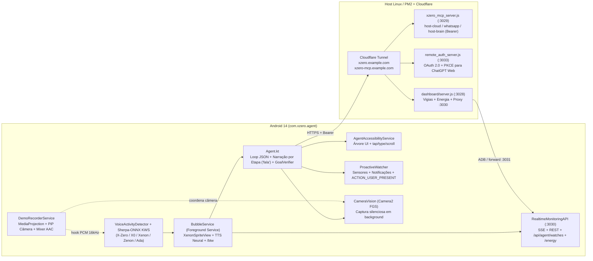

# Arquitetura Técnica — X-Zero / ADA (`agente-phone`)

Documento técnico completo cobrindo o agente Android (`app/`), pipeline de voz e visão, orquestração cognitiva, servidores MCP via Cloudflare, dashboards unificados (`:3028` e `:3030`), gravador de demonstração (`DemoRecorderService`) e suíte de testes JVM (`testbed/`).

---

## 1. Visão Geral da Arquitetura

---

## 2. Núcleo Android (`app/src/main/java/com/xzero/agentephone/`)

### 2.1 Ciclo de Vida, Bolha e Avatar (`BubbleService.kt`, `XenonSpriteView.kt`)
- **Foreground Service (`microphone|camera|specialUse`):** mantém escuta de voz contínua, renderização do mascote Xenon e servidor local `:3030`.
- **Anúncio de Inicialização (`announceStartupSystemsReady`):** ao inicializar o `TextToSpeech`, verifica em tempo real `AgentAccessibilityService.instance`, sensores ativos, `OfflineWakeWordSpotter.isReady` e quantidade de servidores MCP `online`, falando *"Iniciando cognição. Tudo ativo, X-Zero pronto!"* (ou apontando exatamente o módulo que não subiu).
- **Desbloqueio de Tela (`ACTION_USER_PRESENT`):** `BroadcastReceiver` dinâmico chama `ProactiveWatcher.onDeviceUnlocked()`.

### 2.2 Pipeline de Voz e Wake Word (`VoiceActivityDetector.kt`, `OfflineWakeWordSpotter.kt`, `AmbientContextEngine.kt`)
- **VAD Normalizado em dBFS + SNR:** adapta o piso de ruído dinamicamente e só alimenta o **Sherpa-ONNX Zipformer** (`assets/kws/keywords.txt`) quando há energia vocal acima do piso.
- **Aliases de Wake Word:** `X-Zero`, `X0`, `Xenon`, `Zenon`, `Ada` e `Reploid`, com regex fonética tolerante a variações do STT em português (`AmbientContextEngine.kt`).
- **Hook PCM sem Conflito (`onPcmFrameListener`):** compartilha os frames 16 kHz PCM lidos pelo VAD para o `DemoRecorderService` gravar a voz do usuário sem abrir um segundo `AudioRecord`.
- **`/btw` em Paralelo:** detecta interrupções do usuário durante a execução de uma tarefa para ajustar rota, pausar ou cancelar sem reiniciar o contexto.

### 2.3 Loop Cognitivo e Verificação (`Agent.kt`, `KnowledgeGraphMemory.kt`, `HealthMonitor.kt`)
- **Roteamento Multi-Provedor:** inicia no modelo rápido (`gemini-3.1-flash-lite`) e escala automaticamente para modelos mais fortes (`gemini-3.5-flash`) em estagnação ou falha.
- **Narração Natural por Etapa (`"fala"`):** o próprio LLM retorna o campo `"fala"` no JSON de cada passo com verbo no gerúndio + onde + pra quê (ex.: *"Entendi, abrindo o iFood pra buscar o lanche"*), com cadência controlada (`>= 2,2s` entre ações distintas) para não atropelar o TTS.
- **GoalVerifier & Auto-Cura (`HealthMonitor.kt`):**
  - Retry de JSON inválido usa prefixo `formato_invalido:` para não gerar falso positivo de falha no `GoalVerifier`.
  - `calculateBackoffMs` usa `attemptCount.coerceAtLeast(0)` para evitar `IllegalArgumentException` caso a acessibilidade caia com a janela zerada.

### 2.4 Câmera Silenciosa e Vigias (`CameraVision.kt`, `ProactiveWatcher.kt`)
- **`capture_camera` em Background:** usa `Camera2` (`TEMPLATE_STILL_CAPTURE`) com `FOREGROUND_SERVICE_CAMERA` declarado no `AndroidManifest.xml`, garantindo fechamento de `CameraDevice` e `ImageReader` no `finally`.
- **Vigias Proativas (`ProactiveWatcher.kt`):**
  - Monitora notificações (`NotifListener`) e desbloqueio (`onDeviceUnlocked()`).
  - Vigias pontuais de desbloqueio (sem `"sempre"`/`"toda vez"`/`"todo dia"`) são removidas automaticamente após disparar; vigias recorrentes respeitam cooldown de `60s`.

---

## 3. Modo Demo / X-Zero Studio (`DemoRecorderService.kt` + `DemoProjectionActivity.kt`)

Gravador integrado ao app para criar vídeos de demonstração no próprio Android:
- **Captura de Tela:** `MediaProjection` + `VirtualDisplay` em `MediaCodec` H.264 (`video/avc`, 30 fps).
- **Janela PiP Flutuante de Câmera:** `TextureView` arrastável com botão explícito **`📷 Traseira`** / **`🤳 Frontal`** (alterna frontal ↔ traseira em ~300 ms sem parar a gravação; relevante para aparelhos cujo HAL de câmera retorna `concurrentSets: []`).
- **Áudio Duplo (Mixer AAC):**
  - Voz do usuário via `VoiceActivityDetector.onPcmFrameListener` (com fallback automático para `AudioRecord(MIC)` quando o Modo Live estiver desativado).
  - Áudio interno do X-Zero (TTS) via `AudioPlaybackCaptureConfiguration`.
  - Sempre alimenta frames contínuos no encoder AAC para garantir sincronização e inicialização imediata do `MediaMuxer`.
- **Saída:** salvo direto na Galeria via `MediaStore` em **`Movies/XZeroDemo/xzero_demo_YYYYMMDD_HHmmss.mp4`**.
- **Coordenação:** `CameraVision.captureSnapshot()` pausa temporariamente a câmera do PiP se precisar capturar uma foto durante a gravação.

---

## 4. MCPs, Segurança Cloudflare e ChatGPT Web (`mcp/`)

| Serviço | Porta Local | Rota Pública (`xzero-mcp.example.com`) | Autenticação | Uso |
| :--- | :--- | :--- | :--- | :--- |
| `xzero-mcp-hub` (`xzero_mcp_server.js`) | `3029` | `/mcp/host-cloud`, `/mcp/whatsapp`, `/mcp/host-brain`, `/setup-phone` | Bearer Token (`~/.cloudflared/xzero_mcp_token`) | MCPs usados pelo celular em 4G/5G/Wi-Fi |
| `xzero-mcp-remote` (`remote_auth_server.js`) | `3033` | `/mcp`, `/.well-known/*`, `/authorize`, `/token`, `/register` | OAuth 2.0 + PKCE (`S256`) | Conector Custom MCP no **ChatGPT Web** |

- O roteamento por path em `~/.cloudflared/xzero_mcp_config.yml` permite que celular (Bearer) e ChatGPT Web (OAuth) coexistam no mesmo domínio HTTPS.

---

## 5. Observabilidade Unificada (`:3028` e `:3030`)

- **No Celular (`RealtimeMonitoringAPI.kt` + `assets/monitoring.html` na porta `:3030`):**
  - `/api/agent/thinking`, `/errors`, `/metrics`, `/audio`, `/harness-insights`, `/api/agent/watches`, `/api/agent/energy` (incluindo `Sensor.getPower()` em mA e troca de modo `normal`/`eco`).
- **No PC / Web (`dashboard/server.js` + `dashboard/public/index.html` na porta `:3028` / `https://xzero.example.com`):**
  - Abas dedicadas para **Visão Geral**, **Logs & Trajetórias**, **👁️ Vigias & Agenda**, **🔋 Energia & Sensores** (`dumpsys batterystats` por subsistema, UID→pacote, sensores e ferramentas), **🧠 Monitor :3030** (proxy via `/api/monitoring3030` + rota `/monitoring`), **Grafo Vetorial**, **Tools** e **Configuração LLM/Cloudflare**.

---

## 6. Suíte de Testes Offline (`testbed/`)

- **`./testbed/run.sh`:** compila `app/src/main/java/` na JVM contra `android.jar` (API 35) + Robolectric e executa **56 testes unitários/integrados** (incluindo `FakeLlm` sem rede e `BugsConhecidosTest`) + **3 cenários** no aparelho falso (`alarme_01`, `regra_bloqueio_01`, `whatsapp_01`) em ~20s sem precisar de aparelho conectado.
